# Image Upscaling

This is a comparison of different image upscaling techniques from traditional interpolation to today's GANs, transformers and diffusion models.  Shows all run on the same images. Includes a local batch tool and a web demo.

<!-- **[Try it here →](https://image-upscaling.pages.dev)** -->

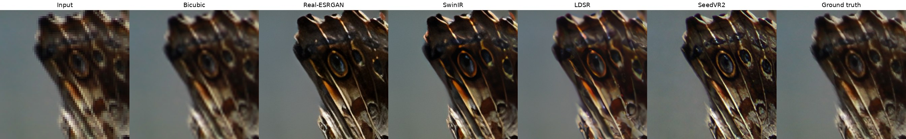

Each test image is a 1024×1024 crop from a photo, downscaled 4x to 256×256 and then upscaled back. In every figure, **Input** is the small image enlarged with plain pixel repetition, so you see what the model was given. **Ground truth** is the full-resolution crop, so every result can be checked against what the camera actually captured.

## From interpolation to diffusion

| Method | Year | Approach | Time, 256→1024 | Mean PSNR |
|---|---|---|---|---|
| Nearest neighbor | | Repeat each pixel | 0.3 ms (CPU) | 36.0 dB |
| Bilinear | | Linear blend of 4 neighbors | 4 ms (CPU) | 38.2 dB |
| Bicubic | 1981 | Cubic fit over 16 neighbors | 5 ms (CPU) | 39.1 dB |
| Lanczos | 1979 | Windowed sinc filter | 8 ms (CPU) | 39.4 dB |
| Bicubic + unsharp mask | | Interpolate, then boost edges | 27 ms (CPU) | 35.2 dB |
| [Real-ESRGAN](https://github.com/xinntao/Real-ESRGAN) | 2021 | CNN + GAN, trained on synthetic real-world degradations | 0.3 s | 32.2 dB |
| [SwinIR](https://github.com/JingyunLiang/SwinIR) | 2021 | Swin transformer + GAN | 2.2 s | 31.6 dB |
| [LDSR](https://huggingface.co/CompVis/ldm-super-resolution-4x-openimages), 100 steps | 2021 | Latent diffusion | 12 s | 32.6 dB |
| [SeedVR2](https://huggingface.co/ByteDance-Seed/SeedVR2-3B) 3B | 2025 | One-step diffusion transformer | 6 s | 31.3 dB |

GPU times on my local RTX 3060. All learned models here are permissively licensed (BSD-3 or Apache-2.0).

**Classical methods** can only redistribute the pixels they are given. Each step up the table trades blockiness for blur; sharpening restores apparent edges but adds halos.

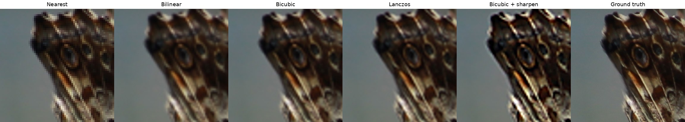

**Learned methods** have seen millions of images and predict the missing detail.

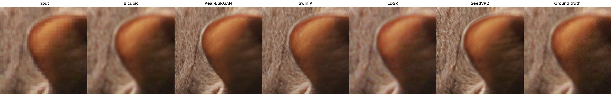
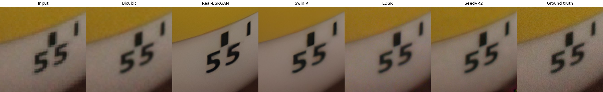
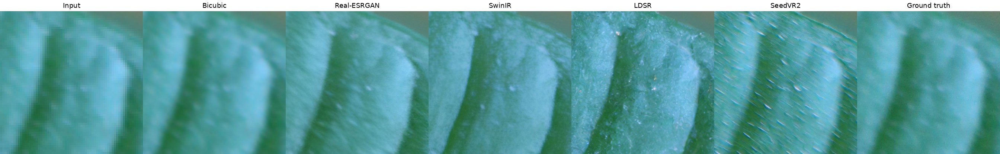

**Observations**

- **Real-ESRGAN** is fast and clean. Strong edges and large markings come out crisp, but fine texture such as fur and leaf surface is smoothed, and small text breaks apart (see [Using the wrong model](#using-the-wrong-model)).
- **SwinIR** looks much like Real-ESRGAN on these photos, at 7x the cost.
- **LDSR** gives natural photographic texture, at the highest cost. 50 steps looks the same as 100 at half the time.
- **SeedVR2** recovers the most convincing detail, as in the wing scales and fur, at half LDSR's time.
- **Generative models invent detail.** On the leaf, LDSR adds a crystalline texture and SeedVR2 adds streaks the real leaf does not have: plausible detail, not recovered detail.
- **PSNR favors blur.** Lanczos and bicubic score highest against the ground truth because averaging minimizes pixel error. Pixel metrics alone would pick a blurry result over a sharp, plausible one.

**Large images.** The local models process images in overlapping tiles, so GPU memory stays under 3 GB at any size. A 2000×1333 photo upscales to 8000×5332 in 13 s with Real-ESRGAN.

## Which model for what

What matters most is the **kind of degradation** a model was trained on, then the **kind of content**.

- **Degradation.** Early models (ESRGAN 2018, classical SwinIR) learned from clean downscaled images. On real photos with blur, noise or JPEG compression they sharpen the artifacts too. Real-ESRGAN, BSRGAN and real-world SwinIR are trained on synthetic camera and compression damage, and clean it up as they enlarge.
- **Photos vs illustration.** Illustration models keep flat color and line art crisp, but turn photographic texture into flat painted shapes. Photo models handle simple flat art acceptably.
- **Faces.** People notice small face errors, so faces get dedicated restorers (GFPGAN, CodeFormer) that run after a general upscaler.
- **Small text.** Any learned model can produce sharp, wrong characters. Check numbers by eye; for documents, blurry is safer than wrong.
- **Scene type.** General models are trained on mixed photos and are not specialized by subject, so landscapes and people use the same models. Large diffusion models (SeedVR2, SUPIR) handle any content well, at the price of invented detail.

## Using the wrong model

Each experiment has a known ground truth, so failures are measured against it.

**An illustration model on a photo.** Real-ESRGAN anime ([x4plus_anime_6B](https://github.com/xinntao/Real-ESRGAN/blob/master/docs/anime_model.md)), trained on anime and line art, turns texture and soft gradients into flat painted shapes. Real-ESRGAN photo (x4plus) is the general model.

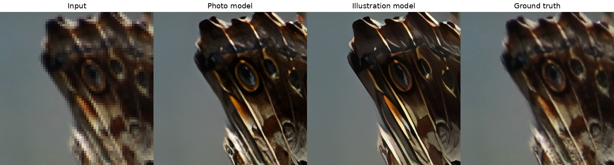

**A model trained on clean images, given a JPEG,** treats the 8×8 compression blocks as detail and sharpens them. Real-world models remove the blocks, but what compression destroyed, like the wing's eyespots, stays lost.

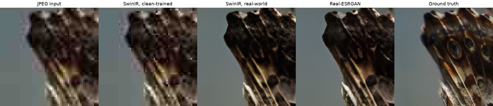

**Small text** (6 px tall in the input) exposes invented detail. Real-ESRGAN sharpens each stroke into broken, unreadable shapes; LDSR garbles a few letters; SeedVR2 reads it almost perfectly. Bicubic is blurry but never wrong.

The difference is what each model knows. Real-ESRGAN is a small network (17M parameters) that looks only at a few pixels around each point, so it sharpens strokes without knowing they form letters. SeedVR2 is a 3B-parameter transformer trained on a vast amount of images and video, with attention across the whole image: it has effectively learned what letters look like and redraws them. That works when the font is common and the text is plausible; with an unusual font or ambiguous input, the same ability can produce confident, wrong characters (not tested here).

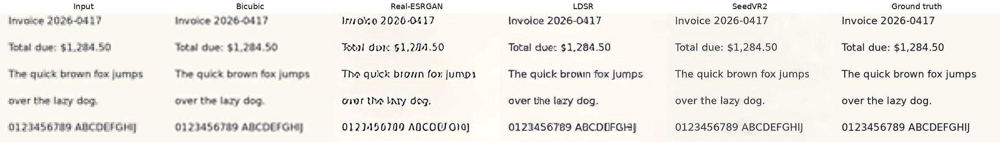

**Flat illustration** is forgiving: every method does well, and Real-ESRGAN anime gives the cleanest edges.

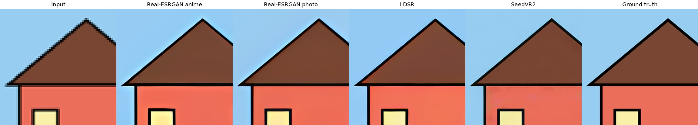

## Repairing damaged photos

Restoration is a different job from upscaling: remove noise, compression, blur or scratches without changing the size. Each clean 512×512 crop was damaged in a known way, then repaired.

| Damage | Classical | Task-specific network | SeedVR2 | Mean PSNR: damaged → best |
|---|---|---|---|---|
| High-ISO noise | Non-local means | [SCUNet](https://github.com/cszn/SCUNet) | Invents colored texture | 21.5 → 29.3 dB |
| JPEG, quality 15 | Bilateral filter | [FBCNN](https://github.com/jiaxi-jiang/FBCNN) | Invents detail | 33.1 → 35.8 dB |
| Motion blur | Wiener, given the exact blur | [FFTformer](https://github.com/kkkls/FFTformer) | Sharpens, little recovery | 31.5 → 35.4 dB |
| Scratches and dust | Telea inpaint | [LaMa](https://github.com/advimman/lama) | Keeps them | 20.6 → 35.8 dB |

A small network trained for one kind of damage wins every case, in 1.5 s or less. The generative upscaler treats damage as content: it sharpens scratches instead of removing them.

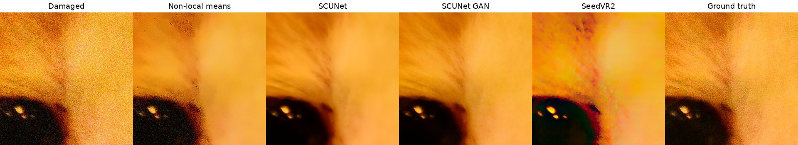
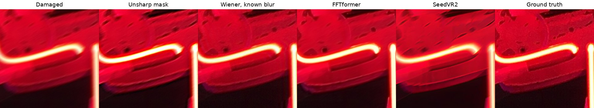
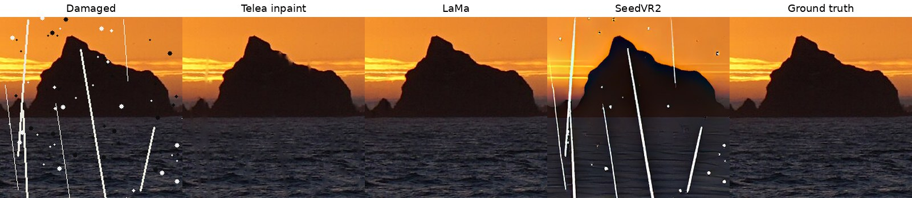

**An old print** combines soft focus, grain, scratches and JPEG. Chaining a denoiser and an inpainter recovers the most; scratch removal needs a mask of where the damage is, painted by hand or detected.

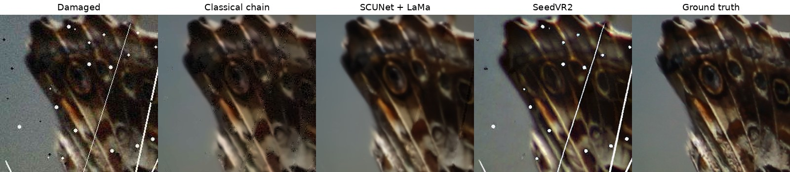

For a damaged photo that also needs enlarging: repair first, then upscale.

## Gallery

Creative Commons images, each a 1024×1024 crop downscaled to 256×256 and upscaled 4x. Credits in [CREDITS.md](CREDITS.md).

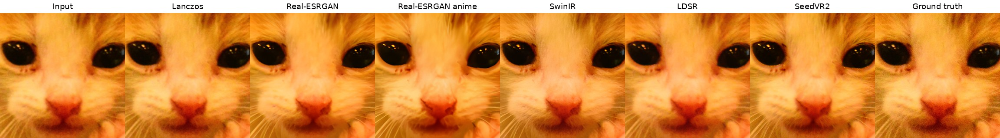
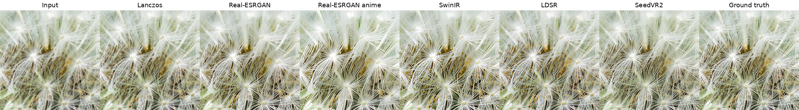
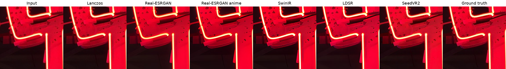
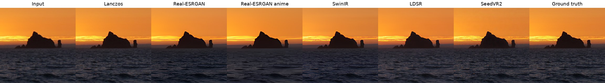
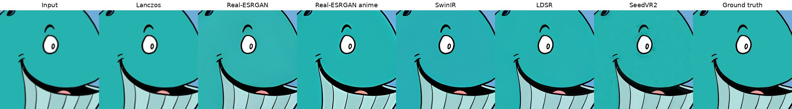

## Where the field is going

- **One-step diffusion.** Distilled models (OSEDiff, SeedVR2) bring diffusion quality to GAN-like speed.
- **Diffusion transformers.** Newer models (SeedVR2, VOSR) replace the U-Net with a transformer and handle arbitrary output sizes.
- **Video.** The same models are moving to temporally consistent video upscaling (SeedVR2, FlashVSR).
- **Licensing** varies widely, and several strong models (SUPIR, many community fine-tunes) restrict commercial use. See the [model survey](research/model_survey_2026-10.md).

## Usage

Batch upscale on a local GPU:

```bash
uv venv --python 3.11 .venv
uv pip install --python .venv/bin/python torch torchvision --index-url https://download.pytorch.org/whl/cu124
uv pip install --python .venv/bin/python diffusers transformers accelerate spandrel pillow

.venv/bin/python src/upscale.py photos/ -o upscaled/              # Real-ESRGAN photo 4x
.venv/bin/python src/upscale.py art.png -m illustration-x4        # line art and flat color
.venv/bin/python src/upscale.py photo.jpg -m swinir-x4            # SwinIR real-world 4x
.venv/bin/python src/upscale.py small.png -m ldsr --steps 50      # latent diffusion
.venv/bin/python src/upscale.py photo.jpg -m lanczos              # classical baseline, CPU
.venv/bin/python src/upscale.py noisy.jpg -m denoise              # repair at same size: denoise, dejpeg, deblur
```

SeedVR2 runs through [ComfyUI-SeedVR2](https://github.com/numz/ComfyUI-SeedVR2_VideoUpscaler), as a ComfyUI node or its standalone CLI.

## Repository

| Path | Contents |
|---|---|
| `src/upscale.py` | Local batch tool: classical interpolation, Real-ESRGAN, SwinIR, LDSR, plus denoise, JPEG and deblur repair; tiled for any image size |
| `demo/` | Web demo: Cloudflare Pages front end, GPU inference on Modal, rate limited (deployment in progress) |
| `validation/` | Benchmark scripts, setup, raw timings and PSNR |
| `research/` | Survey of current upscaling models and their licenses |
| `*.ipynb` | Original notebooks: Real-ESRGAN, LDSR, and an SRGAN-based cartoon upscaler |
